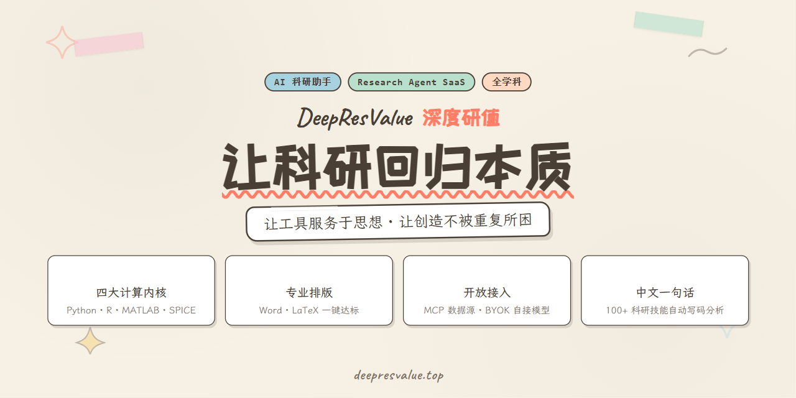

<!-- DeepResValue (深度研值) — Public Repository README -->
<!-- Keywords: AI research assistant, 科研 Agent, SaaS, academic, data analysis -->

  

<h1 align="center">DeepResValue 深度研值</h1>

  <strong>AI Research Assistant for the Whole of Science</strong> 
  <em>让科研回归本质，让工具服务于思想，让创造不被重复所困</em>

  <a href="https://deepresvalue.top/">Website</a> · <a href="#quick-start">Quick Start</a> · <a href="#documentation">Docs</a> · <a href="LICENSE">License</a>

---

## What is DeepResValue?

**DeepResValue (深度研值)** is an **AI research assistant Agent SaaS** platform built for researchers, graduate students, and faculty across all academic disciplines. It lets you drive complex research workflows with a single sentence in Chinese — the **科研 Agent** handles the rest: coding, data analysis, literature search, writing, and professional typesetting.

> *"让科研回归本质，让工具服务于思想，让创造不被重复所困"*

**深度研值**是面向全学科科研工作者的 **AI 科研助手 Agent SaaS**。一句中文驱动，Agent 自动完成编码分析、文献检索、论文写作与专业排版——让科研回归本质。

---

## Core Capabilities

### Four Compute Kernels

| Kernel | Language | Use Cases |
|--------|----------|-----------|
| 🐍 Python | Python 3 | Data analysis, machine learning, NLP, visualization |
| 📊 R | R | Statistical modeling, econometrics, bioinformatics |
| 🔬 MATLAB / Octave | MATLAB-compatible | Signal processing, control systems, numerical computing |
| ⚡ SPICE (ngspice) | SPICE netlist | Circuit simulation, analog/digital design verification |

### Professional Typesetting

- **Word** — Automated report generation with institutional templates
- **LaTeX** — Publication-ready papers, equations, and bibliography management

### Extensible by Design

- **MCP Connectors** — Connect external data sources, APIs, and tools via the Model Context Protocol
- **BYOK (Bring Your Own Key)** — Plug in your own LLM provider keys (DeepSeek, OpenAI, Qwen, etc.)

### One Sentence, Full Traceability

- 中文一句话驱动复杂科研全流程
- Every reasoning step, code execution, and data transformation is **fully traceable** and auditable

> 100+ professional research skills guide the Agent through domain-specific workflows.

---

## Supported Disciplines & Scenarios

- **Social Sciences & Humanities** — Survey analysis, qualitative coding, content analysis, bibliometrics
- **STEM & Engineering** — Statistical inference, simulation, signal processing, circuit design
- **Medical & Life Sciences** — Survival analysis, meta-analysis, clinical data processing
- **Finance & Economics** — Panel data, time-series forecasting, event studies, risk modeling
- **Interdisciplinary** — Literature review, systematic review, reproducibility workflows, competition modeling

---

## Research Pain Points → DeepResValue Solutions

| Pain Point | DeepResValue Solution |
|------------|----------------------|
| Repetitive coding for standard analyses | Agent auto-writes and runs code in 4 compute kernels |
| Scattered literature across databases | Integrated literature search + structured extraction |
| Formatting papers to journal specs | Word & LaTeX professional typesetting built-in |
| Hard to reproduce past analyses | Full execution trace with data provenance |
| Limited by one programming language | Multi-kernel: Python, R, MATLAB/Octave, ngspice |
| Need external data sources | MCP connector framework for extensible data access |

---

## Validation & Milestones

- 🎓 **3,000+ users** from 985/211 universities — professors, PhD/Master students, and researchers
- 📈 **Thousands of real-world research projects** validated across disciplines
- ✅ **Product-Market Fit (PMF) achieved** — now in formal launch and growth phase
- 🏫 **Founder**: graduate of a 985 university, with deep domain expertise in AI × research workflows

---

## Quick Start

1. Visit **[deepresvalue.top](https://deepresvalue.top/)** and sign up
2. Select your research mode (Academic / Mentor / Professional)
3. Describe your research task in one sentence — the AI Agent takes it from there

**开始使用**：访问 [deepresvalue.top](https://deepresvalue.top/)，注册后选择科研模式，一句中文描述任务即可开始。

---

## Documentation

This repository contains the public documentation and product introduction for DeepResValue.

| Document | Path | Description |
|----------|------|-------------|
| Documentation Hub | [`docs/README.md`](docs/README.md) | Documentation index |
| Product Intro (中文) | [`docs/product-intro.zh.md`](docs/product-intro.zh.md) | 产品介绍 |
| Product Intro (English) | [`docs/product-intro.en.md`](docs/product-intro.en.md) | Product introduction |
| User Guide (中文) | [`docs/user-guide.zh.md`](docs/user-guide.zh.md) | 用户指南 |
| User Guide (English) | [`docs/user-guide.en.md`](docs/user-guide.en.md) | User guide |
| Getting Started | [`docs/getting-started/`](docs/getting-started/) | Setup, interface overview, quick start |
| Features | [`docs/features/`](docs/features/) | Academic writing, data analysis, AIGC detection, etc. |
| Account | [`docs/account/`](docs/account/) | Credits, ambassador, invites, settings |
| Research Modes | [`docs/modes/`](docs/modes/) | Academic, Mentor, Professional modes |
| FAQ | [`docs/faq/`](docs/faq/) | Frequently asked questions |

For AI agents and coding assistants, see [`AGENTS.md`](AGENTS.md) and [`llms.txt`](llms.txt).

---

## License

This documentation repository is licensed under [**Creative Commons Attribution 4.0 International (CC BY 4.0)**](LICENSE).

SPDX License Identifier: `CC-BY-4.0`

You are free to share and adapt this material for any purpose, provided you give appropriate credit.

---

  © 2024–2026 DeepResValue 深度研值 · <a href="https://deepresvalue.top/">deepresvalue.top</a>

